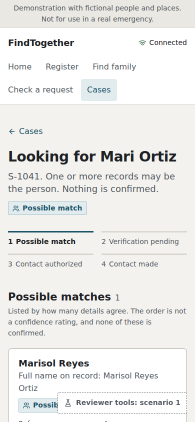
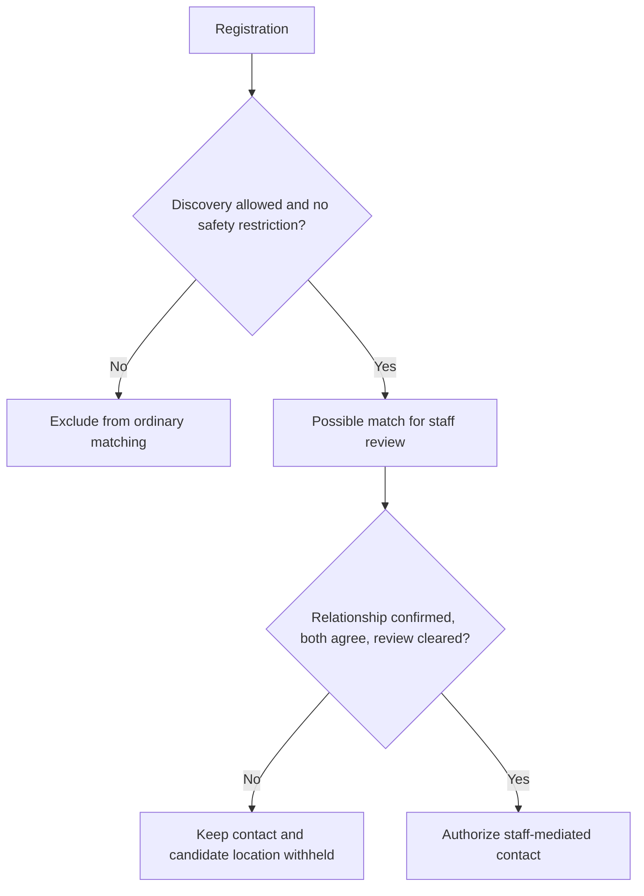
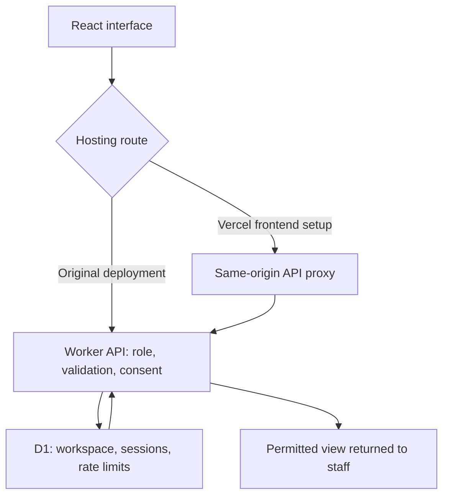

# FindTogether

**A consent-first family reunification app for the DALI Fullstack Challenge 26F.**

**[Open the live demo](https://findtogether-haaris.quietyak18.chatgpt.site)**

## Overview

After an evacuation, finding someone is only half the problem. The other half is making sure they want to be found—and that the person searching is someone they actually want to contact.

FindTogether focuses on the shelter desk. A volunteer can register a displaced person, record a search for a family member, and print a reference slip. A coordinator can review possible matches, confirm a relationship, record both people's agreement, and arrange contact.

The app does not automatically reunite people or publish a directory of evacuees. It helps staff decide what to do next.

**Demo note:** All starting records are fictional. Anyone can try either staff role in their own isolated demo workspace. This role selector is for evaluation, not production staff authentication. Please do not enter real personal information.

### At a glance

| Built | Deliberately out of scope |
| --- | --- |
| Staff-assisted intake and family searches | A public people-search directory |
| Server-enforced consent and role checks | Real staff identity verification |
| Explainable matching and contact approval | Automatic identity decisions or outbound calls |
| Persistent SQL data and retry-safe submissions | Offline sync and agency integrations |

[Try it](#try-the-demo) · [Visual walkthrough](#visual-walkthrough) · [Design](#design) · [Technical choices](#technical-choices) · [Run locally](#running-locally)

## Try the demo

**Start with Coordinator for the case-review flow, or Volunteer for intake.** Each new demo workspace comes with fictional cases so you can explore without entering data first.

| Try this | What to look for |
| --- | --- |
| Coordinator → Cases → **S-1041** | “Mari Ortiz” may be Marisol Reyes. Review the evidence, begin verification, confirm the relationship, record both people's agreement, and authorize contact. |
| Coordinator → Cases → **S-1042** | Several Joe/José records fit. Flag the ambiguity for additional review instead of treating the first result as the answer. |
| Coordinator → Cases → **S-1043** | A child's search is routed to safeguarding rather than ordinary matching. This is a status, not an actual agency referral. |
| Volunteer → Register | Add a fictional person, save the receipt, then refresh. Saved records persist in the database. |
| Volunteer → Find family → search for **Robert Tran**, about **30–44** | The seeded Bobby Tran record demonstrates nickname matching. Switch to Coordinator to review the resulting case. |
| Search for **Ana Ruiz** | Her protected record must not appear as a candidate. The requester should learn nothing about her registration or location. |

**A useful failure check:** try to authorize contact before completing verification. The app should refuse. Buttons record what staff say happened; they do not call anyone or independently verify identities.

Role changes retain the current workspace. The demo token is kept in the browser tab; refresh preserves it, but closing the tab can end access. A cookie may also retain access where supported. An unrelated browser starts a separate workspace. Sessions expire after seven days; expired data is cleaned when a subsequent session is created.

## Visual walkthrough

> **Screenshot provenance:** These four images show Claude's original frontend prototype, not a fresh capture of the deployed build. The current app adds demo role/shelter selectors and server enforcement. In particular, the older case screenshots show shelter locations before authorization; the current backend withholds candidate locations until contact is authorized. The old “Reviewer tools” panel is not part of the deployed HTTP interface.

### 1. A volunteer at the shelter desk

A person arrives without a working phone or ID. The volunteer needs two clear actions: register them or record who they are looking for. A reference slip gives them something to bring back later without needing an account or device.


**Example:** Someone gives only “Lena” and an approximate age. Staff can record that incomplete information. If they have not yet agreed to family search, their registration stays out of matching until permission is recorded.

### 2. A plausible match still needs verification

Daniel asks for his sister “Mari Ortiz.” She registered as “Marisol Reyes.” The app compares names, ages, places, and family notes, and exposes both agreements and differences so the coordinator can reason about the match.


**What this demonstrates:** A nickname or shared family name can justify a closer look, but it cannot authorize contact. The coordinator records the relationship check, each person's agreement, and the chosen contact method before contact details become available.

### 3. Sometimes the correct next step is more information

Inés is looking for her father, Joe or José Martinez. Three records look plausible; two might even describe the same person registered at different shelters. Picking the first record would conceal that uncertainty.


**Example review note:** “Ask Inés for her father's middle name and where he was staying.” A review flag preserves that question for the next coordinator and blocks contact authorization while review is outstanding.

### 4. Case review on a narrow screen

Staff may have access to a shared phone even when the displaced person does not. The interface keeps the case status and possible-match language visible on a narrow screen.



*This is a prototype mobile screenshot, not evidence of a new browser accessibility audit.*

### How the consent gate works



Children follow a separate safeguarding path. An apparent match never overrides a safety restriction or a refusal.

### Two examples where no result is the right result

| Situation | Staff-facing behavior | What the requester learns |
| --- | --- | --- |
| Ana is registered but protected | Her record is excluded before matching. | The request remains active; nothing reveals that Ana is registered. |
| A named person has not registered | No candidate is available. | The same limited active-request status. |

That similarity is intentional. A search must not become a way to discover whether someone has sought shelter or refused contact.

## The full picture

### What I chose to build, and why

I chose the workflow from **shelter intake to staff-mediated contact**. It addresses people who have no phone, no ID, or incomplete information, while keeping a person involved in decisions that software should not make alone.

The implemented workflow includes:

- Registration with a name, nickname, or description, plus explicit consent choices.
- Family search requests and printable reference slips.
- Explainable possible matches, duplicate hints, and human review.
- Relationship verification and separate contact agreements from both people.
- Contact authorization, contact-made status, and case history.
- A real HTTP backend, persistent SQL storage, and server-enforced access rules.

### Where it fits in a larger response

A real response would connect vetted staff across shelters and participating agencies to a shared incident database. Hotels and relatives' homes could be represented through agency contact points, without publishing private addresses.

Paper intake would remain available during outages. Staff would later enter those forms, reconcile duplicates, and update transfers between shelters. Safeguarding specialists would handle children and other cases requiring additional protection. Interpreters and accessible intake options would help people who cannot use the standard process.

Those operational pieces are not built here. In particular, the safeguarding status does **not** send a referral to an actual agency, and the app does **not** automatically contact family members.

## Design

### Who uses it

| User | What they need | Design response |
| --- | --- | --- |
| Displaced person | Help without a phone, ID, or willingness to share a legal name | Staff-assisted registration, optional identity details, consent choices, printed reference |
| Shelter volunteer | A clear next step while handling a long queue | Focused intake/search forms, validation, receipts, simple request status |
| Reunification coordinator | Enough evidence to review a possible match safely | Evidence comparisons, review flags, verification steps, controlled contact release |

### Edge cases and assumptions

| Situation | Implemented behavior or limitation |
| --- | --- |
| Someone does not want to be found | Safety concerns override consent. Protected records are excluded before matching. |
| Consent is missing | Unknown matching consent does not permit discovery. |
| A child is involved | Child registrations do not enter ordinary matching; child searches route to safeguarding. Unknown age still requires staff judgment. |
| Names differ or information is incomplete | Normalization, nickname rules, approximate ages, and visible evidence support review. No automatic identity decision is made. Description-only registration is supported, but automatic discovery from descriptions is not. |
| Someone claims a relationship | Staff must record confirmation before either contact-consent step. The software records the process; it cannot establish the truth of the claim. |
| Contact is declined or permission withdrawn | A declined pair cannot restart verification. Withdrawing consent invalidates active authorizations. Previously viewed information cannot be made unseen. |
| A requester checks progress | The response shows only active or contact arranged, without revealing matches, locations, protection flags, or refusal. |
| Connection fails | Unsaved form contents remain in memory while the page stays open. There is no offline synchronization; paper intake is the proposed fallback. |
| A submission is retried | A submission key returns the original receipt. Reusing it with different data is rejected. |
| Two updates happen together | A database revision check prevents one update silently overwriting the other. |

A reference slip identifies a request; it is not proof of identity. Volunteers are assigned to one shelter at a time. The Demo shelter selector lets reviewers switch that assignment among the four fictional locations; switching clears unsaved forms. Volunteer intake fields use the assigned shelter, while coordinators can select any shelter in each form. A person has one current shelter per registration, not multiple simultaneous locations. The deployment is a prototype, not a system validated for real disaster response.

## Technical choices

| Part | Choice | Why |
| --- | --- | --- |
| Frontend | React, TypeScript, Tailwind, React Router | Preserve the supplied interface and keep forms, components, and data access separate |
| Backend | TypeScript HTTP endpoints served through Vinext on a Cloudflare Worker | Serve the frontend and API from one origin using the available deployment environment |
| Database | Cloudflare D1, a SQLite-based SQL database | Persist records across page reloads and server requests |
| Schema and input checks | Drizzle migrations and Zod validation | Version the database structure and validate requests on the server |
| Matching | Explainable name and age rules | Give staff inspectable evidence rather than an unexplained identity score |

### Request and data flow



The Vercel configuration is committed; its live connection has not yet been verified. Both deployment paths are designed to use the same existing backend.

The browser calls `/api/*`. The server loads records, checks the session's role, runs matching, enforces consent, and returns only the permitted view. Hiding a field in the UI is not the privacy boundary.

An opaque demo token is sent in `X-Findtogether-Session` and stored in sessionStorage, with an in-memory fallback. This avoids relying on cookies in embedded browsers. Tokens are hashed in the database, expire, and rotate on role changes. The token is JavaScript-accessible, so this is a demo workspace mechanism, not production staff authentication. Production would require vetted accounts and real shelter assignments.

API responses are not cached. Writes check origin, and SQL-backed rate limits apply per session and hashed IP address. These measures do not constitute a complete security audit or a guarantee against timing side channels.

### Biggest tradeoff

Each small demo workspace is stored as a JSON snapshot inside a SQL row. Sessions and rate limits have separate tables. This makes a complete workflow update atomic and keeps the implementation manageable, but every update rewrites the snapshot and matching scans the records.

**This storage design is not intended for a region of 400,000 people.** The demo allows roughly 500 records per workspace. At operational scale, I would separate registrations, searches, pair reviews, verification steps, and audit events into indexed tables, then introduce an asynchronous matching pipeline. Case history here is append-only through the app, not a tamper-evident audit system.

## Running locally

Use **Node 24** and **pnpm**. From the project directory:

```sh
pnpm install --frozen-lockfile
pnpm test
pnpm typecheck
pnpm build
```

After the first build, initialize the local database:

```sh
node --import ./scripts/sites-env.mjs ./node_modules/wrangler/bin/wrangler.js d1 execute DB --local --config dist/server/wrangler.json --persist-to .wrangler/state --file drizzle/0000_rare_bug.sql
node --import ./scripts/sites-env.mjs ./node_modules/wrangler/bin/wrangler.js d1 execute DB --local --config dist/server/wrangler.json --persist-to .wrangler/state --file drizzle/0001_tiresome_loa.sql
pnpm dev
```

Apply each migration only once to each database. Local and hosted databases are separate. The hosted deployment uses the checked-in hosting configuration and migration files; managed publishing applies the hosted migrations and deploys the Worker and frontend assets.

### Important files

- `src/screens/`, `src/components/`: interface and forms.
- `src/services/http/`: frontend API client.
- `src/domain/`: matching and consent rules.
- `server/engine.ts`: server-side case workflow.
- `server/handler.ts`: HTTP routing, sessions, access checks, and database updates.
- `server/validation.ts`: request schemas.
- `db/schema.ts`, `drizzle/`: SQL schema and migrations.
- `docs/API.md`: endpoint contract and integration notes.
- `src/services/mock/`: original mock implementation and tests, retained for comparison; not the deployed data source.

## Testing and verification

**52 automated tests passed during the Vercel preparation**, covering matching, privacy, form validation, server-side roles, invalid inputs, persistent writes, workspace isolation, concurrent writes, retry deduplication, contact gating, consent withdrawal, and children's cases.

Backend integration tests execute the generated migrations against real SQLite through a small D1 adapter. A regression test uses the real HTTP client without cookies to check navigation requests, registration, role switching, and session expiry. TypeScript and production-build checks passed during implementation. Four proxy tests additionally cover session/idempotency forwarding, cross-origin rejection, authentication and empty responses, and upstream failures.

Deployment has succeeded. Automated browser verification of the hosted app was unavailable in the development environment, so manual browser testing remains part of the submission check. The app has not been load-tested at disaster scale or tested with actual response staff.

## AI process

I split the work between Claude for the initial frontend and ChatGPT for backend integration and deployment.

- **Claude:** frontend screens, forms, domain rules, mock API, initial tests, API contract, and prototype screenshots.
- **ChatGPT:** server workflow, persistent API and database integration, demo sessions, backend validation, regression tests, deployment, and this README.
- **Review changes:** withheld candidate shelter locations until contact authorization and invalidated authorizations when consent is withdrawn.
- **Debugging:** after I reported repeated session errors in the hosted app, ChatGPT replaced the cookie-only dependency with an explicit demo token and added a cookie-free regression test.
- **Stack adjustment:** the initial plan used Express/PostgreSQL; the implementation uses a Worker and D1 to fit the available hosting environment while retaining the React frontend.

The central product decision was to prioritize a small, consent-based staff workflow and explain the missing operational pieces, rather than claim to solve the entire reunification system.

## Vercel frontend deployment

The repository also supports a Vercel frontend while the existing Cloudflare/D1 backend remains hosted at the original live URL above. `vercel.json` selects the separate Vite build (`npm run build:frontend`) and `dist-frontend` output. The original `npm run build` remains the backend's Vinext build.

Import `haaris-usman-saeed/findtogether` into Vercel, use the repository root, and choose Node.js 24.x. Keep the build settings supplied by `vercel.json`. No database credentials or frontend environment variables are needed. Once deployed, use the actual Vercel production URL as the submission link; a Vercel URL has not yet been verified here.

Browser requests stay on `/api` on the Vercel domain. A small Node function (`api/proxy.ts`) forwards requests to the fixed backend, preserving session tokens, idempotency keys, status codes, and JSON bodies. It checks the incoming origin before setting the upstream origin, does not forward browser cookies, and disables API caching. Client-side page URLs fall back to `index.html` so refreshes work.

The database is not migrated or copied. Existing demo sessions on the original domain do not transfer automatically because session storage is scoped to each domain; choose a demo role again on Vercel. The backend must remain published. This split adds a network hop and the backend's IP rate limit may be shared by visitors using a Vercel egress address; it is suitable for the evaluation demo, not regional emergency traffic.

After deployment, open the production URL in a private browser window, choose each demo role, change shelters, register a fictional person, refresh a nested page, and confirm the record persists. Check `/api/health` returns `{"ok":true,"storage":"sql"}`. Local tests validate proxy behavior and the production frontend build, but do not establish connectivity from Vercel to the live backend.

AI process note: Codex prepared the separate frontend build and API proxy, and expanded this README with seeded-case walkthroughs, the existing mobile screenshot, and architecture/consent diagrams. No new live screenshots were captured for this documentation update.
